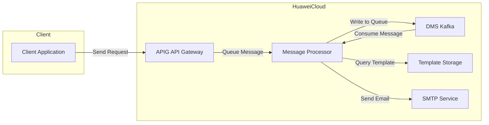

# Multi-Channel Messaging Platform


> A multi-channel message sending platform built on Huawei Cloud DMS Kafka, supporting SMS, email and other message channels.

## 1. Overview

This project is a multi-channel message sending platform based on Huawei Cloud DMS Kafka message queue, providing:

- **Message Queue Processing**: Uses DMS Kafka as message middleware, supporting high-throughput message processing
- **Multi-Channel Sending**: Supports email sending (via SMTP) and SMS sending
- **Template Storage**: Supports dynamic management and storage of message templates

Suitable for enterprise scenarios requiring large-scale push messaging, such as e-commerce promotions, member notifications, system alerts, etc.

## 2. Table of Contents

- [1. Overview](#1-overview)
- [2. Table of Contents](#2-table-of-contents)
- [3. Architecture](#3-architecture)
- [4. Key Features](#4-key-features)
- [5. Cloud Services & Costs](#5-cloud-services--costs)
- [6. Prerequisites](#6-prerequisites)
- [7. Quick Start](#7-quick-start)
- [8. Step-by-Step Deployment](#8-step-by-step-deployment)
- [9. Usage & Verification](#9-usage--verification)
- [10. Cleanup](#10-cleanup)
- [11. Detailed Documentation](#11-detailed-documentation)
- [12. License](#12-license)
- [13. Contact](#13-contact)

## 3. Architecture



**Architecture Description**:
1. Client submits message sending request through APIG API Gateway
2. Message processor writes request to DMS Kafka queue
3. Consumer fetches and processes messages from Kafka
4. Retrieves message templates from template storage during processing
5. Sends emails via SMTP service

## 4. Key Features

- **High Throughput**: Based on DMS Kafka, supports millions of messages/second processing
- **Async Decoupling**: Message queue decouples producers and consumers
- **Elastic Scaling**: Supports on-demand scaling of message processing capacity
- **Cost Optimization**: Pay-as-you-go, no need to pre-provision resources

## 5. Cloud Services & Costs

| Huawei Cloud Service | Usage | Billing Model |
|---------------------|-------|---------------|
| DMS Kafka | Message Queue | Pay-as-you-go (instance spec + storage) |
| APIG | API Gateway | Per call/traffic |
| VPC | Virtual Private Cloud | Per bandwidth/traffic |
| RDS MySQL | Template Storage (optional) | Pay-as-you-go |

**Cost Notice**:
- DMS Kafka is billed hourly, please execute cleanup after completion
- APIG is billed per call, large-scale testing may incur costs

## 6. Prerequisites

- Huawei Cloud account (with following services enabled):
  - DMS Kafka
  - APIG (optional)
  - VPC
- Terraform CLI >= 1.5
- Python 3.8+ (for message processor)
- Docker (for building images)

**Region Constraints**:
- Recommended regions: cn-north-4, cn-east-3
- DMS Kafka has been verified in these regions

## 7. Quick Start

### 1. Clone Repository

```bash
git clone <repository-url>
cd sample-multichannel-messaging-api-with-template
```

### 2. Configure Credentials

Create `infra/credentials.env`:

```bash
HW_ACCESS_KEY=your_access_key
HW_SECRET_KEY=your_secret_key
```

### 3. One-Click Deployment

```bash
cd infra
terraform init
terraform apply
```

## 8. Step-by-Step Deployment

### Step 1: Initialize Terraform

```bash
cd infra
terraform init
```

**Expected Output**:
```
Terraform has been successfully initialized!
```

### Step 2: Validate Configuration

```bash
terraform validate
```

**Expected Output**:
```
Success! The configuration is valid.
```

### Step 3: Deploy Resources

```bash
terraform apply
```

**Expected Output**:
```
Apply complete! Resources: 5 added, 0 changed, 0 destroyed.
```

## 9. Usage & Verification

### Get Kafka Connection Info

```bash
terraform output
```

### Verify Message Queue Available

Test with Kafka client:

```bash
# List Kafka topics
kafka-topics.sh --list --bootstrap-server <kafka-endpoint>

# Test producing messages
echo "test message" | kafka-console-producer.sh --bootstrap-server <kafka-endpoint> --topic messages
```

### Verify Message Processing

After deploying message processor, check logs:

```bash
kubectl logs -f <pod-name>
```

## 10. Cleanup

**Important**: Always execute cleanup after completion to avoid ongoing billing!

```bash
# Destroy all resources
terraform destroy

# Verify cleanup
terraform output
```

## 11. Detailed Documentation

### Configuration Parameters

| Variable | Description | Default |
|----------|-------------|---------|
| region | Deployment region | cn-north-4 |
| project_name | Project name | multichannel-messaging |
| kafka_flavor_id | Kafka flavor | c6.2u4g.cluster |
| broker_num | Broker count | 3 |

### API Endpoints

| Endpoint | Description |
|----------|-------------|
| POST /api/v1/messages | Send message |
| GET /api/v1/templates | Get template list |
| POST /api/v1/templates | Create template |

### Workflow

1. Client calls API to submit message sending request
2. API Gateway receives and validates request
3. Message is written to DMS Kafka queue
4. Consumer fetches message from queue
5. Query template storage to get template
6. Call SMTP service to send email
7. Log sending results

## 12. License

MIT License

## 13. Contact

- Maintainer: Shangdongd
- Email: support@example.com
- Issue Reporting: Please submit GitHub Issue
