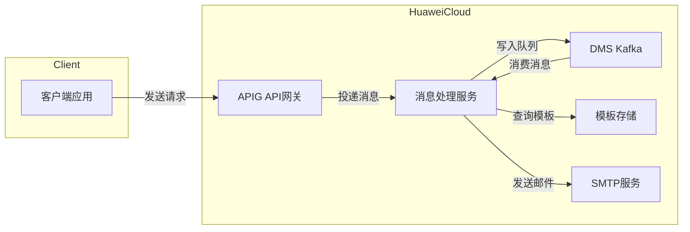

# 多渠道消息发送平台


> 基于华为云 DMS Kafka 构建的多渠道消息发送平台，支持短信、邮件等多渠道消息处理。

## 一、简介 / 概述

本项目是一个基于华为云 DMS Kafka 消息队列的多渠道消息发送平台，实现以下功能：

- **消息队列处理**：使用 DMS Kafka 作为消息中间件，支持高吞吐量消息处理
- **多渠道发送**：支持邮件发送（通过 SMTP）和短信发送
- **模板存储**：支持消息模板的动态管理和存储

适用于需要处理大量推送消息的企业场景，如电商促销、会员通知、系统告警等。

## 二、目录

- [一、简介 / 概述](#一简介--概述)
- [二、目录](#二目录)
- [三、架构图](#三架构图)
- [四、方案亮点](#四方案亮点)
- [五、涉及云服务与费用](#五涉及云服务与费用)
- [六、前置条件](#六前置条件)
- [七、快速开始](#七快速开始)
- [八、分步部署](#八分步部署)
- [九、使用方法 / 验证](#九使用方法--验证)
- [十、清理资源](#十清理资源)
- [十一、详细说明](#十一详细说明)
- [十二、许可证](#十二许可证)
- [十三、联系方式](#十三联系方式)

## 三、架构图



**架构说明**：
1. 客户端通过 APIG API 网关提交消息发送请求
2. 消息处理服务将请求写入 DMS Kafka 消息队列
3. 消费者从 Kafka 消费消息并处理
4. 处理过程中从模板存储获取消息模板
5. 通过 SMTP 服务发送邮件

## 四、方案亮点

- **高吞吐量**：基于 DMS Kafka 实现百万级消息/秒处理能力
- **异步解耦**：消息队列实现生产者和消费者解耦
- **弹性扩展**：支持按需扩展消息处理能力
- **成本优化**：按需付费，无需预置资源

## 五、涉及云服务与费用

| 华为云服务 | 用途 | 计费模型 |
|------------|------|----------|
| DMS Kafka | 消息队列 | 按需付费（实例规格 + 存储） |
| APIG | API 网关 | 按调用次数/流量计费 |
| VPC | 虚拟私有云 | 按带宽/流量计费 |
| RDS MySQL | 模板存储（可选） | 按需付费 |

**费用提醒**：
- DMS Kafka 集群按小时计费，请务必在完成后执行清理操作
- APIG 按调用次数计费，大量测试可能产生费用

## 六、前置条件

- 华为云账号（需开通以下服务）：
  - DMS Kafka
  - APIG（可选）
  - VPC
- Terraform CLI >= 1.5
- Python 3.8+（用于消息处理服务）
- Docker（用于构建镜像）

**区域约束**：
- 推荐区域：cn-north-4、cn-east-3
- DMS Kafka 在这些区域经过验证

## 七、快速开始

### 1. 克隆仓库

```bash
git clone <repository-url>
cd sample-multichannel-messaging-api-with-template
```

### 2. 配置凭据

创建 `infra/credentials.env` 文件：

```bash
HW_ACCESS_KEY=your_access_key
HW_SECRET_KEY=your_secret_key
```

### 3. 一键部署

```bash
cd infra
terraform init
terraform apply
```

## 八、分步部署

### 步骤 1：初始化 Terraform

```bash
cd infra
terraform init
```

**预期输出**：
```
Terraform has been successfully initialized!
```

### 步骤 2：验证配置

```bash
terraform validate
```

**预期输出**：
```
Success! The configuration is valid.
```

### 步骤 3：部署资源

```bash
terraform apply
```

**预期输出**：
```
Apply complete! Resources: 5 added, 0 changed, 0 destroyed.
```

## 九、使用方法 / 验证

### 获取 Kafka 连接信息

```bash
terraform output
```

### 验证消息队列可用

使用 Kafka 客户端测试：

```bash
# 查看 Kafka 主题
kafka-topics.sh --list --bootstrap-server <kafka-endpoint>

# 测试生产消息
echo "test message" | kafka-console-producer.sh --bootstrap-server <kafka-endpoint> --topic messages
```

### 验证消息处理

部署消息处理服务后，查看日志：

```bash
kubectl logs -f <pod-name>
```

## 十、清理资源

**重要**：务必在完成后执行清理，避免持续计费！

```bash
# 销毁所有资源
terraform destroy

# 确认清理完成
terraform output
```

## 十一、详细说明

### 配置项说明

| 变量 | 说明 | 默认值 |
|------|------|--------|
| region | 部署区域 | cn-north-4 |
| project_name | 项目名称 | multichannel-messaging |
| kafka_flavor_id | Kafka 规格 | c6.2u4g.cluster |
| broker_num | Broker 数量 | 3 |

### API 接口

| 接口 | 说明 |
|------|------|
| POST /api/v1/messages | 发送消息 |
| GET /api/v1/templates | 获取模板列表 |
| POST /api/v1/templates | 创建模板 |

### 工作流程

1. 客户端调用 API 提交消息发送请求
2. API 网关接收请求并验证
3. 消息写入 DMS Kafka 队列
4. 消费者从队列获取消息
5. 查询模板存储获取模板
6. 调用 SMTP 服务发送邮件
7. 记录发送结果到日志

## 十二、许可证

MIT License

## 十三、联系方式

- 维护者：Shangdongd
- 邮箱：support@example.com
- 问题反馈：请提交 GitHub Issue
